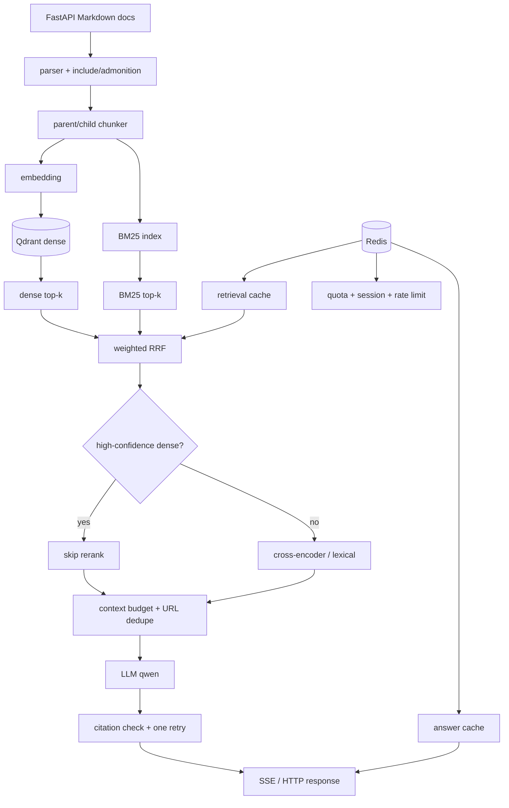
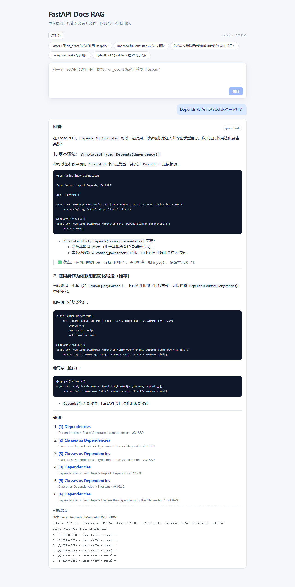

# FastAPI 技术文档 RAG

[](https://github.com/u7465990/fastapi-docs-rag/actions/workflows/ci.yml)

面向 FastAPI 官方技术文档的 RAG 问答系统：支持中文提问检索英文文档、回答可追溯到 chunk → section → URL，并在检索不到时明确拒答。

项目签名是**版本感知的活知识库**：文档变更可感知、增量可索引、回答可标注适用版本。

> 当前状态：Phase 1 进行中。解析、父子切分、embedding、Qdrant indexer、dense + BM25 hybrid retrieval（`/api/v1/search`）、RAG 问答（`/api/v1/chat`）、SSE 流式回答（`/api/v1/chat/stream`）、多轮会话、Docker API 和 Nginx 静态托管的聊天页已可用；已有 30 条检索评估、24 条生成/引用/拒答评估（21 pass）、cross-encoder 可选 rerank、精确答案缓存、版本意图路由、manifest 增量索引、查询改写、低分拒答、上下文预算/去重、引用重试、async API/SSE、并发压测报告、CI 和 HTTP 限流/额度锁；下一步是 RAGAS 与历史 collection 检索。

## 架构



关键链路：

- 离线：Markdown → include 解析 → 父子切分 → embedding → Qdrant；变更用 `content_sha256` 复用向量。
- 在线：dense + BM25 → RRF → 高置信度跳过 rerank 或 cross-encoder → 上下文预算 → LLM → citation 校验。
- 缓存：答案缓存和检索结果缓存都带 `source_ref + build_id`，索引切换后失效。
- 可观测：响应/SSE `done` 带 `timings`；前端“调试信息”展示改写 query、阶段耗时和各来源分数。



演示材料：[3 分钟 Demo 脚本](docs/DEMO_SCRIPT.md)。

## 数据源

- 仓库：[`fastapi/fastapi`](https://github.com/fastapi/fastapi)（MIT）
- 快照：`7a0a3f0b286c6c865cf4398ea0e957a87b8bffa4`（2026-10-23），对应 FastAPI `0.162.0`
- 英文文档：`docs/en/docs/**/*.md`（156 个）
- 代码示例：`docs_src/**/*.py`（485 个）

本地数据位于 `data/raw/fastapi/`，已被 `.gitignore` 排除，不进入仓库。当前工作区是文件快照（不含 `.git`）；如果要做真正的 Git 变更检测，先按下面命令重建 sparse checkout。没有 `.git` 时，增量索引仍可通过 `content_sha256` 工作，`source_ref` 用 `DOCS_SOURCE_REF` 或上一版 manifest 继承：

```bash
git clone --filter=blob:none --no-checkout https://github.com/fastapi/fastapi.git data/raw/fastapi
cd data/raw/fastapi
git sparse-checkout init --cone
git sparse-checkout set docs/en docs_src fastapi
git checkout master
```

> `fastapi/` 只用于解析 `how-to/configure-swagger-ui.md` 中对 `fastapi/openapi/docs.py` 的代码 include，不索引其源码。

release notes 默认只把最近 20 个版本切进普通索引（`RELEASE_NOTES_LATEST_VERSIONS`）；历史版本后续通过 git tag 重建，避免 changelog 主导检索。

## 快速开始

环境由 [uv](https://docs.astral.sh/uv/) 管理（`uv >= 0.13`；CPython 3.12 由 uv 托管，仓库已提交 `uv.lock`）。

```bash
# 1. 依赖（首次）
uv sync --extra dev                 # core + pytest / ruff / mypy
uv sync --extra dev --extra rag     # 接 LangChain / LangGraph 时再装

# 2. 配置
cp .env.example .env                # Windows PowerShell: Copy-Item .env.example .env
# 然后填入 LLM_API_KEY、EMBEDDING_API_KEY
uv run --no-sync python scripts/check_providers.py   # 先验证 Key / 模型 / 端点

# 3. 构建并启动 Qdrant + Redis + API + Web（Web 在 Docker 内 npm build）
docker compose up -d --build
docker compose logs -f api

# 4. 建索引（需要 EMBEDDING_API_KEY，且 Qdrant 已启动）
uv run --no-sync python scripts/ingest.py

# 5. 用固定问题跑检索 smoke
uv run --no-sync python scripts/smoke_search.py

# 6. 打开 http://localhost:8080（生产模式，不用 vite dev）
```

开发时仍可单独跑 `cd apps/web && npm install && npm run dev`，Vite 会把 `/api` 代理到 `127.0.0.1:8000`；这个 5173 端口只用于本机开发，不要暴露到公网。生产镜像不依赖本机 `dist`，`Dockerfile.web` 在容器内执行 `npm ci && npm run build`。

API 默认跑在 Docker 里。调试时也可以停掉 api 容器，改用宿主机：

```bash
docker compose stop api
uv run --no-sync python -m fastapi_docs_rag.cli
```

索引默认写入临时 collection `fastapi_docs_build_<ts>`，成功后原子切换 alias `fastapi_docs_current`；旧 build 保留用于回滚。只想看切分和版本字段时加 `--dry-run`，不调用 embedding。

### 版本感知与增量索引

- `scripts/update_index.py`：读取上一版 `data/manifests/index_manifest.json`，按 `chunk_id + content_sha256` 复用旧向量，只 embed 变更 chunk。
- `scripts/diff_report.py`：报告 changed docs/chunks、reused chunks、`source_ref` 和 `stale_hours`。
- payload 同时写 `docs_version`、`source_ref`、`index_build_id`。
- 没有 `.git` 的快照可用 `DOCS_SOURCE_REF` 指定 commit；若已有 manifest，会自动继承上一版 `source_ref`。

```bash
# 第一次建 manifest；已有索引时会复用全部未变向量
uv run --no-sync python scripts/update_index.py

# 只报告，不写索引
uv run --no-sync python scripts/diff_report.py

# 全量重建
uv run --no-sync python scripts/ingest.py
```

实测修改一篇文档后：

```text
changed_docs: 1
changed_chunks: 1
reused_vectors: 1362
embedded_vectors: 1
```

改回原文后再跑一次，仍然只重新 embed 1 个 chunk。

### LLM 额度锁

API 用 Redis 做应用层每日额度锁，调用 LLM 前先预占 token，超限直接返回 429，不再请求模型：

```dotenv
LLM_MAX_TOKENS=1024
LLM_MAX_TOKENS_CAP=512
LLM_DAILY_REQUEST_LIMIT=50
LLM_DAILY_TOKEN_BUDGET=300000
```

`LLM_MAX_TOKENS_CAP` 是单次硬上限；后两项是每天请求数 / token 预算。Redis 不可用时返回 503，不会绕过额度直接调用模型。

### HTTP 限流、embedding 额度和 access token

```dotenv
RATE_LIMIT_PER_MINUTE=30
EMBEDDING_DAILY_REQUEST_LIMIT=500
EMBEDDING_DAILY_TOKEN_BUDGET=200000
API_ACCESS_TOKEN=
```

- `/api/v1/search` 和 `/api/v1/chat` 都按 IP 做每分钟限流；超限返回 429。
- 每次检索/问答都会消耗一次 embedding 额度；embedding 超限同样返回 429。
- `API_ACCESS_TOKEN` 为空时不做鉴权（本地开发默认）；设置后请求需要：
  - `Authorization: Bearer <token>`，或
  - `X-API-Key: <token>`
- 前端如果要在开启 token 后使用，构建时设置 `apps/web/.env`：

```dotenv
VITE_API_TOKEN=同一个token
```

注意：前端 bundle 里的 token 用户可见，只是演示门禁，不是真正的用户登录。真正上线需要账号体系。

Nginx 会设置 `X-Real-IP`，限流按这个 IP 计数；直接暴露 API 时该 header 可被伪造，所以生产必须只让 API 通过 Nginx 访问。

### 流式回答

`POST /api/v1/chat/stream` 返回 `text/event-stream`，顺序固定为：

```text
sources -> token* -> usage -> done
```

- `sources` 先到，前端可以先显示来源
- `token` 是增量文本
- `usage` 当前为 `null` 计数（OpenAI 兼容流不一定返回 usage）
- `done` 表示结束
- 生成异常会发 `error`，不会静默截断

前端用 `fetch` + `ReadableStream` 解析，不能用原生 `EventSource`（它只支持 GET）。Nginx 的 `/api` 已关闭 `proxy_buffering`，否则流会被整段缓冲。

### 并发与延迟

`/api/v1/search`、`/api/v1/chat`、`/api/v1/chat/stream` 已改为 async；阻塞的检索/embedding/Redis 操作通过线程池 offload，LLM 使用 `httpx.AsyncClient`。SSE 为 async generator。

本地 Docker 实测：

```text
检索 20 并发 p95: 496ms -> 533ms（无明显提升，瓶颈在 embedding/Qdrant）
检索 100 并发: 100 x 200, p95 3.70s, 25.1 rps
Chat 5 并发 p95: 6.34s -> 5.42s
SSE 5 并发 TTFT p95: 1.10s
Chat 10 并发: 1.16 rps, 0 errors
Chat 20 并发: 20 x 200, p95 29.1s（不可用，仅说明系统不崩）
```

完整数据和限制见 [docs/PERFORMANCE.md](docs/PERFORMANCE.md)。

不要声称“支持 20 并发低延迟 chat”；目前只验证到 10 并发可用、20 并发不报错但很慢、100 并发检索。

### Cross-encoder rerank

真实语义 rerank 用 FastEmbed 的 ONNX cross-encoder：

```bash
uv sync --extra dev --extra rerank
```

```dotenv
RERANKER_PROVIDER=fastembed
RERANKER_MODEL=Xenova/ms-marco-MiniLM-L-6-v2
RERANKER_CACHE_DIR=data/cache/fastembed
RERANKER_THREADS=4
```

- 默认用小模型 `Xenova/ms-marco-MiniLM-L-6-v2`（约 80MB，英文 cross-encoder），适合 CPU/demo
- 中文 query 质量优先时换 `BAAI/bge-reranker-v2-m3-int8`（约 570MB，多语言）
- 只 rerank top `RERANK_TOP_K` 个候选
- 模型懒加载，缓存在 `data/cache/fastembed`
- 模型/依赖不可用时自动回退 lexical rerank，不阻断问答
- Docker API 使用 `.[rerank]` 安装可选的 cross-encoder 依赖
- `docker-compose.yml` 把 `./data/cache/fastembed` 挂到容器，重建容器不丢模型
- `RERANK_MIN_SCORE` 可作为语义 OOD 阈值；具体值需用真实模型校准

### RAG 质量控制

```dotenv
RETRIEVAL_MIN_SCORE=0.35
MAX_CONTEXT_TOKENS=8000
CACHE_ENABLED=true
CACHE_TTL_SECONDS=3600
```

- 多轮追问如果是短句/含“它、这个、上述”等指代，会把上一轮用户问题拼进检索 query；不改写回答 query。
- 检索 Top-1 dense 分数低于 `RETRIEVAL_MIN_SCORE` 时直接拒答；cross-encoder 可用时改用 `RERANK_MIN_SCORE` 作为语义 OOD 门槛。
- 上下文按 URL 最多保留 2 条，并按 `MAX_CONTEXT_TOKENS` 截断，避免同一页面刷满 prompt。
- 生成后检查 `[n]`：无效编号、无引用、弱引用支撑会进入 `citation_warnings`；无有效引用会自动重试一次。
- 版本号/版本关键词问题自动路由到 `doc_type=release_notes`；显式 `doc_type` 优先。
- 答案缓存 key 包含 `source_ref + build_id + model + embedding + prompt_version + 请求参数`，精确 query 命中；默认 TTL 1 小时。
- 这是启发式校验，不等于语义 entailment；g03/g22 这类“内容对但引用不是最精确页面”仍需句子级 attribution。

### 多轮会话

请求里带 `session_id` 即可启用多轮：

```json
{"query": "那它和 startup/shutdown 有什么区别？", "limit": 6, "session_id": "..."}
```

- 历史存 Redis：`chat:session:{session_id}:messages`
- 最多保留 12 条消息（约 6 轮），TTL 7 天
- 前端用 `localStorage` 保存 session_id，并提供“新对话”按钮
- 不传 `session_id` 就是单轮，不读写历史
- session_id 不是登录身份；别人拿到它就能读历史，正式上线必须配真实鉴权

### 观测

- 每个请求都有 `X-Request-ID`；不传则自动生成，响应头回传
- 请求日志是 JSON 行，包含 request_id、method、path、status、duration_ms、client
- `GET /metrics` 输出 Prometheus 文本格式：
  - `rag_http_requests_total{method,path,status}`
  - `rag_http_request_duration_ms{path,quantile}`（p50/p95，内存窗口）
  - `rag_tokens_reserved_total{kind}`（LLM/embedding 预占 token）
  - `rag_quota_rejections_total{scope}`
- `/readyz` 负责 Qdrant / Redis / 配置 / LLM 配置检查（LLM 只检查 key+model，不每次发真实 completion，避免烧额度）
- `/metrics` 当前不鉴权，生产只应让内部监控访问，不要直接暴露公网
- 记录的是**预占 token 数**，不是供应商账单金额
- 指标是进程内内存；当前单 worker 足够，多 worker 部署时需要 Prometheus 聚合

```bash
curl -s http://localhost:8000/metrics | head
```

### 可复现构建

两个镜像都从 Docker 构建，不依赖本机产物：

- `Dockerfile.api`：Python 依赖层 + 源码层
- `Dockerfile.web`：Node 阶段执行 `npm ci && npm run build`，Nginx 阶段只复制 `dist`

```bash
# 空环境一条命令构建全部
docker compose up -d --build

# 单独验证干净构建
docker build --no-cache -f docker/Dockerfile.api -t fastapi-docs-rag-api:clean .
docker compose --progress=plain build --no-cache web
```

`make up` 同样会构建全部镜像；它不再要求本机先执行 `npm run build`。

常用命令：

```bash
uv run --no-sync pytest                      # 全部测试
uv run --no-sync pytest tests/unit           # 仅单元测试
uv run --no-sync ruff check .
uv run --no-sync mypy src
uv run --no-sync python scripts/check_parser.py   # 解析器冒烟统计
uv run --no-sync python scripts/check_chunker.py  # 切分统计（token 分布 / 代码块 / 废弃）
uv run --no-sync python scripts/load_search.py    # 8 路并发检索延迟
uv run --no-sync python scripts/evaluate.py       # 30 条 golden set 的 dense 基线
uv run --no-sync python scripts/evaluate.py --mode hybrid --rerank  # hybrid + lexical rerank
uv run --no-sync python scripts/evaluate_generation.py  # 生成/引用/拒答评估
```

`make install` / `make test` / `make lint` 是上面的薄封装；`make up` 会从空环境构建全部镜像（包括前端），不要求本机有 `apps/web/dist`。

启动后：

- API 文档：http://localhost:8000/docs
- 存活检查：http://localhost:8000/healthz
- 就绪检查：http://localhost:8000/readyz（需要 Qdrant、Redis 和模型 Key）

## CI

`.github/workflows/ci.yml` 在 push 到 `main`、PR 和手动触发时运行：

- Python：`uv sync`、`uv lock --check`、ruff、mypy、pytest
- 前端：`npm ci`、`npm run build`
- Docker：构建 API 和 Web 镜像

CI 只读仓库，不推送镜像、不部署、不需要模型 Key；它保证“代码能通过检查、前端能构建、镜像能构建”。

## 文档

- [项目设计](docs/PROJECT_DESIGN.md)：架构、技术选型、FastAPI 数据解析、检索/生成/评估设计、迭代路线
- [RAG 原理](docs/RAG_PRINCIPLES.md)：各环节的底层机制、公式、失败模式与实现风险
- [2026-11-14 工作记录](docs/WORKLOG_2026-11-14.md)：当天的命令、假设、验证结果与决策
- [2026-11-14 名词与原理注解](docs/WORKLOG_2026-11-14_EXPLAINED.md)：工作记录中术语、行为、历史改动与设计原理的解释
- [2026-11-15 工作记录](docs/WORKLOG_2026-11-15.md)：评估、安全、SSE、多轮、可复现构建与观测的当天记录
- [2026-11-15 新名词注解](docs/WORKLOG_2026-11-15_EXPLAINED.md)：当天新增评估/限流/SSE/会话/构建/观测概念的解释
- [检索评估基线](docs/EVALUATION.md)：30 条 golden set、指标、迭代记录与局限
- [Bad Cases](docs/BAD_CASES.md)：已实测的排序/标注问题与修复记录

## 计划技术栈

FastAPI · Qdrant · 自研 parser/chunker · dense + BM25 · RRF · FastEmbed cross-encoder（可选）· Redis · SSE · Vite + React + TypeScript · Docker · GitHub Actions

## 后续计划

按 Phase 0 → 1 → 2 → 2.5 → 3 → 4 → 5 推进：骨架、dense baseline、hybrid + cross-encoder、manifest 增量索引已完成；下一步是模型缓存验证、部署硬化和更完整的生成评估。

## 本地环境

- Python 3.12（uv 托管；`requires-python >=3.11,<3.13`）
- uv 0.13+，依赖版本锁定在 `uv.lock`
- Docker Desktop（仅运行 Qdrant + Redis）
- Node.js 24 / npm 11（前端）
- PyPI 默认走清华镜像（`pyproject.toml` 的 `[tool.uv.index]`），海外环境用 `--default-index https://pypi.org/simple` 覆盖
- 访问 GitHub 需要开启加速器（本机 hosts 将 `github.com` 指向 `127.0.0.1`）
